# Custom STM32H743 Quadcopter Flight Controller

An end-to-end quadcopter project built around a bespoke four-layer flight-controller PCB, a custom 3D-printed airframe and a four-in-one ESC. The assembled board was flashed and configured using Betaflight, integrated into the aircraft and successfully flight-tested outdoors.

[View the full interactive project page](https://zceeamt.github.io/#quadcopter)

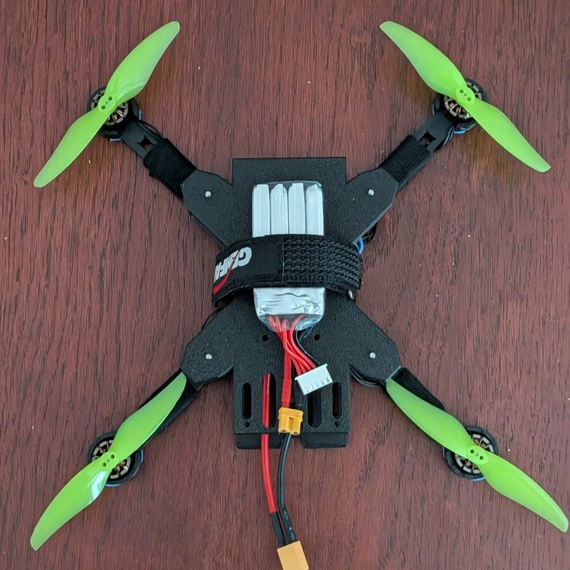

## Project scope

I was responsible for the electronics, PCB layout, mechanical design, assembly and validation. The project progressed through schematic capture, board layout, manufacturing, soldering, power-rail checks, USB and sensor bring-up, Betaflight firmware configuration, ESC integration and outdoor flight testing.

## Flight-controller hardware

The controller is based on an **STM32H743**, a 480 MHz Arm Cortex-M7 microcontroller. It integrates:

- **ICM-42688-P six-axis IMU** on a dedicated SPI bus with a data-ready interrupt
- **DPS368 barometric pressure sensor** on a second SPI bus
- Four timer outputs for a four-in-one ESC through an 8-pin JST-SH connector
- Three UARTs for receiver, GPS and telemetry expansion
- USB-C for power and communication
- SWD and boot-select controls for programming and debugging
- 25 MHz external crystal
- USBLC6 ESD protection on the USB data lines
- Reverse-polarity protection and an AP63203 3.3 V buck regulator

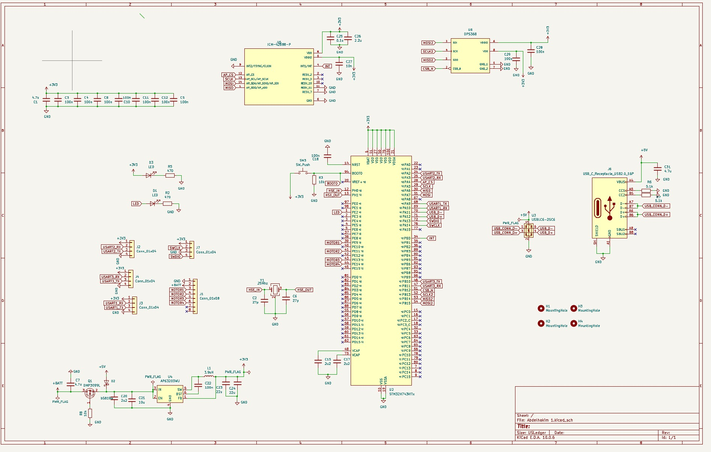

## Four-layer PCB

The PCB uses signal routing on the outer layers, a continuous ground plane on the first internal layer and a dedicated 3.3 V plane on the second internal layer. This gives signals short return paths and distributes power with low impedance.

Placement and routing were driven by signal integrity: the crystal sits beside the MCU, the USB pair is routed together, the IMU interface is kept short and every supply pin is locally decoupled.

| Layer | Purpose |
|---|---|
| F.Cu | Components and signal routing |
| In1.Cu | Continuous ground plane |
| In2.Cu | 3.3 V power plane |
| B.Cu | Signal routing |

| Top render | Bottom render |
|---|---|
| 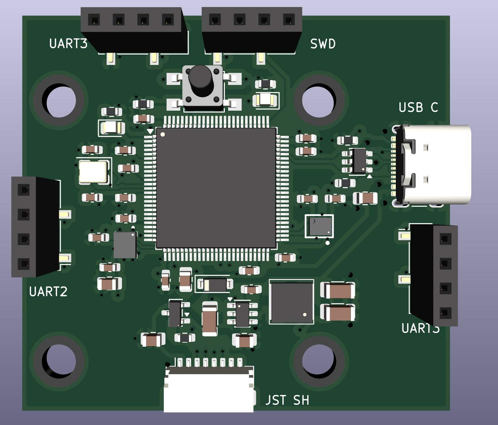 | 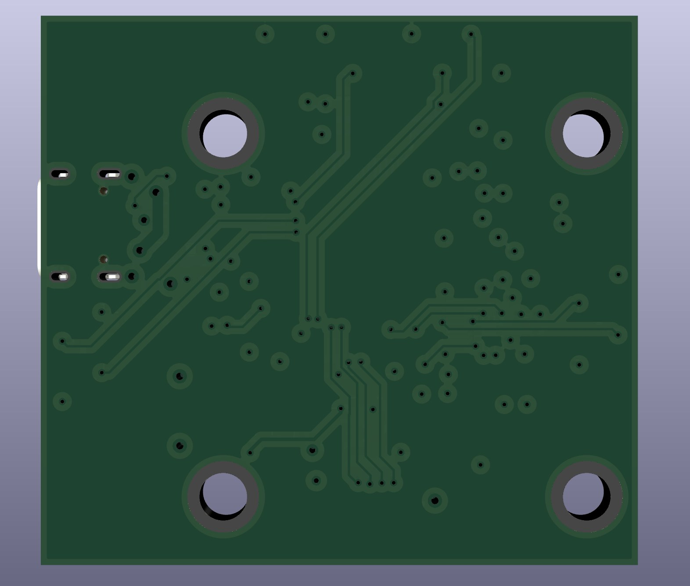 |

| Manufactured board | Rotated view |
|---|---|
| 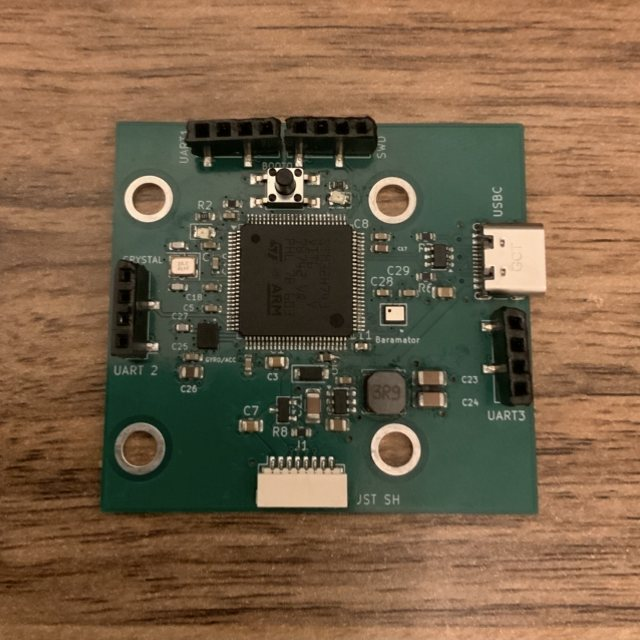 | 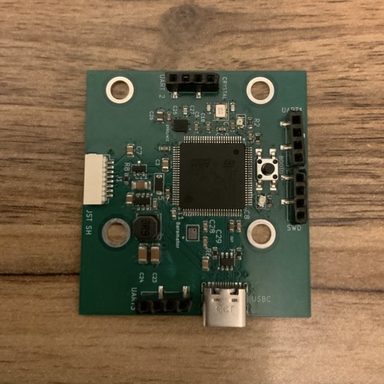 |

## Airframe and system integration

The airframe was designed in Fusion 360 and printed in two materials. A rigid PLA chassis carries the electronics and battery, while flexible TPU motor mounts absorb impacts and reduce vibration reaching the IMU. The prebuilt four-in-one ESC and custom controller are stacked on isolated mounts in the central bay.

| ESC installed | Flight controller installed |
|---|---|
| 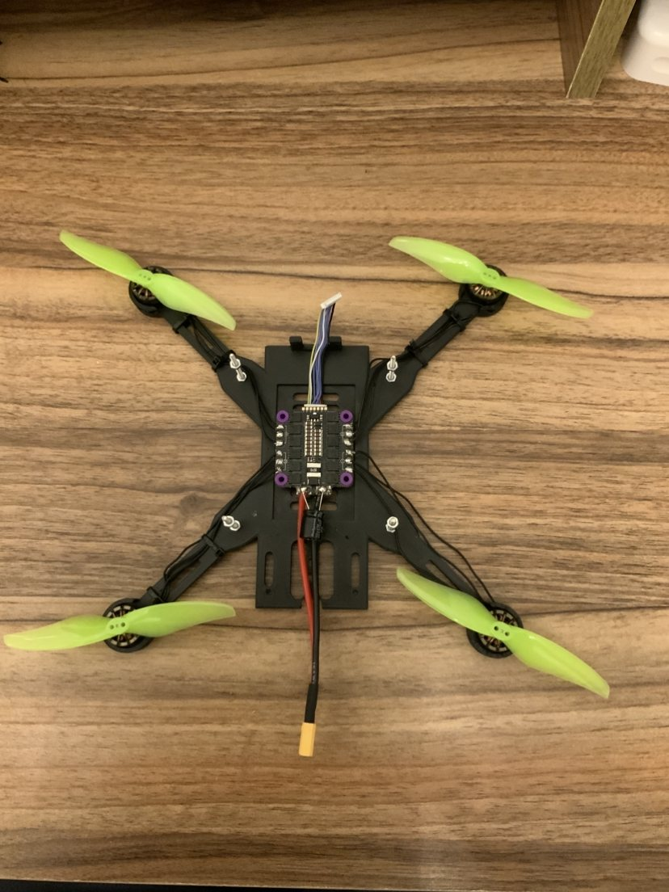 | 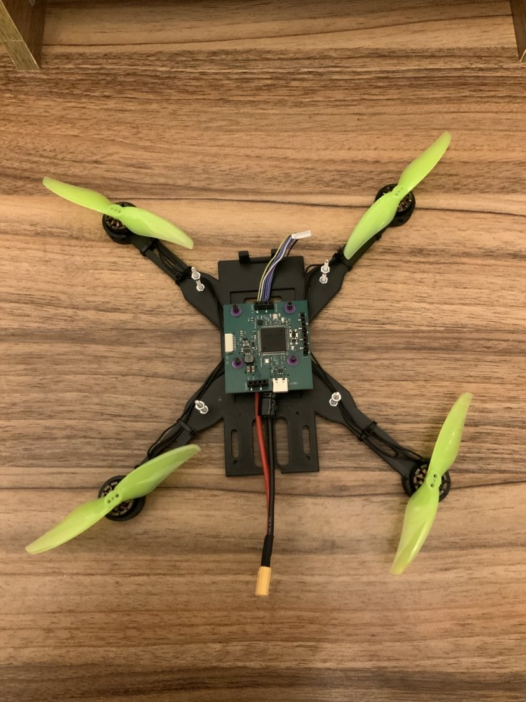 |

## Bring-up and validation

| Initial USB-C power-up | USB-only operation |
|---|---|
| 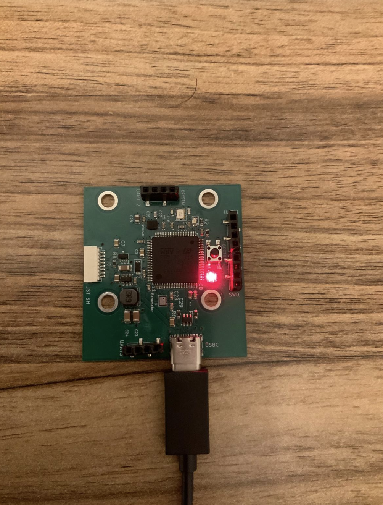 | 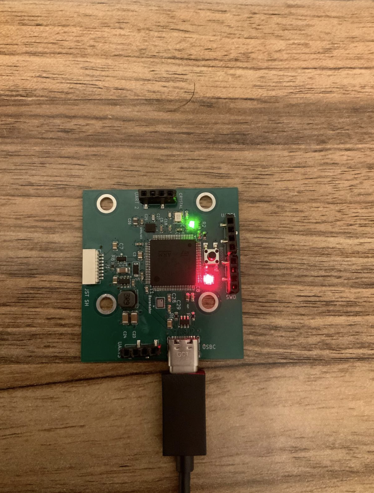 |
| First power-up over USB-C: power LED (red) | Firmware running from USB power: power LED (red) and MCU status LED (green) |

1. Inspected the assembled PCB for fabrication and soldering defects.
2. Verified the power rails before connecting the remaining hardware.
3. Flashed and configured the assembled flight controller using Betaflight, then confirmed USB-C enumeration and firmware communication.
4. Compared physical board motion with Betaflight's live attitude model.
5. Integrated the ESC and mapped each output to the correct motor.
6. Checked motor direction and propeller orientation after frame integration.
7. Completed an outdoor flight test.

| Betaflight connection | Orientation validation |
|---|---|
| 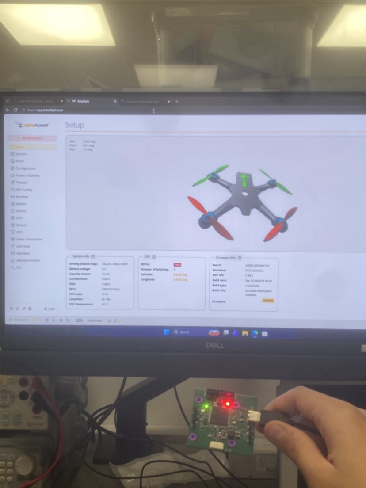 | 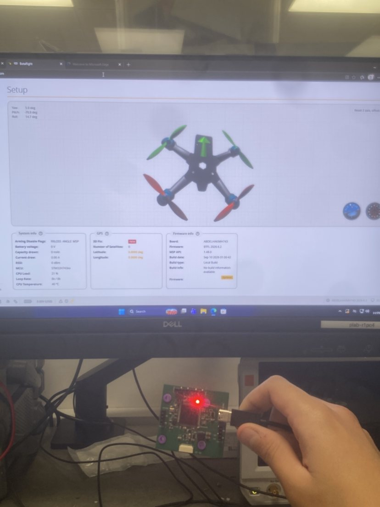 |

The flight-test recording is available at [docs/video/flight-test.mp4](docs/video/flight-test.mp4).

## Technical summary

| Item | Specification |
|---|---|
| Processor | STM32H743, Arm Cortex-M7 at 480 MHz |
| Motion sensing | ICM-42688-P six-axis IMU, SPI plus interrupt |
| Pressure sensing | DPS368 barometer on a second SPI bus |
| Clock | 25 MHz crystal |
| Interfaces | USB-C, SWD and three UARTs |
| Motor control | Four timer channels to a four-in-one ESC |
| PCB | Four layers: signal, ground, 3.3 V and signal |
| Airframe | PLA chassis with TPU motor mounts |
| Configuration | Betaflight |
| Result | Working prototype, outdoor flight completed |

## Skills demonstrated

KiCad, schematic capture, four-layer PCB layout, STM32 hardware, SPI, UART, USB-C, power design, soldering, hardware bring-up, Fusion 360, 3D printing, Betaflight and flight testing.

> This repository documents the completed prototype and engineering process. Native KiCad and mechanical CAD source files can be added as they are cleaned for publication.
